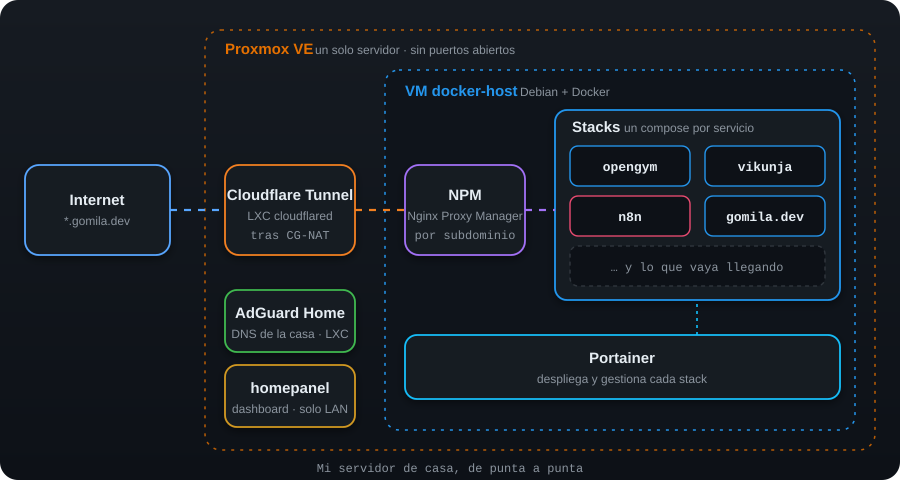

 

**Desarrollador backend Java en Barcelona** · construyo y mantengo aplicaciones empresariales robustas, sobre todo en proyectos de Administración Pública. Fuera del trabajo me gusta montar y automatizar mi propia infraestructura en casa.

 

 

## 💼 Lo que hago

- Senior Software Developer en **Inetum**
- Desarrollo backend con **Java** y **Spring Framework**
- Bases de datos **Oracle**

## 🏠 Mi homelab

Tengo un servidor casero sobre **Proxmox VE** donde aprendo y pruebo cosas de infraestructura. Mi conexión está detrás de CG-NAT, así que expongo los servicios con **Cloudflare Tunnel** bajo mi dominio `gomila.dev`, sin abrir puertos.

<table>
  <tr>
    <td width="50%" valign="top">

**🧱 Infraestructura**
- **Virtualización:** Proxmox VE con una VM Debian para Docker y contenedores LXC para servicios de red
- **Contenedores:** Docker gestionado con Portainer, desplegando cada servicio como stack
- **Red:** Nginx Proxy Manager como reverse proxy y AdGuard Home como DNS de toda la red doméstica

</td>
    <td width="50%" valign="top">

**⚙️ Servicios**
- **Automatización:** instancia propia de **n8n**, con un resumen diario que me llega cada mañana por Telegram (tiempo, noticias, tareas, mercados y novedades de mis apps)
- **Productividad:** gestión de tareas con Vikunja, self-hosted
- **Apps que alojo:** [openGym](https://opengym.gomila.dev), un rastreador de gimnasio con passkeys (proyecto de terceros, lo hospedo yo)

</td>
  </tr>
</table>

> 🔭 Sigo ampliándolo: próximos pasos son más servicios self-hosted, un servidor multimedia y probar modelos de IA ligeros en local.

## 🛠️ Stack

## 🚀 Proyectos

| Proyecto | Qué es |
|---|---|
| [**homepanel**](https://github.com/gomila17/homepanel) | Panel personal para mi entorno doméstico |

 

  Hecho a mano, alojado en casa · <a href="https://gomila.dev">gomila.dev</a>

